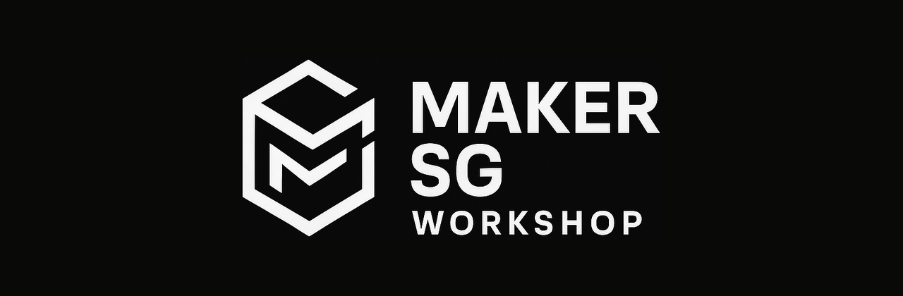

  

<h1 align="center">MakerSG Workshop</h1>

  Box AI ESP32, HUD cho xe, e-ink và vỏ in 3D, thiết kế tại Sài Gòn cho cộng đồng maker Việt Nam.

  
  
  
  
  

---

### 👋 Chúng tôi làm gì

MakerSG là xưởng nhỏ làm phần cứng mở cho người thích tự tay lắp ráp:

- 🤖 **Box AI ESP32**: trợ lý giọng nói chạy firmware [xiaozhi-esp32](https://github.com/78/xiaozhi-esp32), màn hình từ 1.54" đến 3.5".
- 🚗 **HUD cho xe**: màn hiển thị gắn taplo và kính lái, kết nối BLE.
- 📖 **E-ink**: firmware đọc sách và bảng hiển thị e-ink.
- 🧩 **Vỏ in 3D**: thiết kế tham số, in FDM, kèm file và hướng dẫn lắp.

### 🛠️ Công nghệ

  
  
  
  
  
  
  

### 🔗 Liên kết

| | |
|---|---|
| 🌐 Website | [makersg.com](https://makersg.com) |
| 🛒 Cửa hàng | [makersg.com/store](https://makersg.com/store) |
| 📚 Hướng dẫn dự án | [makersg.com/projects](https://makersg.com/projects) |
| 🧡 Shopee | [shopee.vn/makersg](https://shopee.vn/makersg) |
| 🎬 TikTok | [@makersaigon](https://www.tiktok.com/@makersaigon) |

---

  Made in Sài Gòn 🇻🇳 · <a href="https://makersg.com">makersg.com</a>

